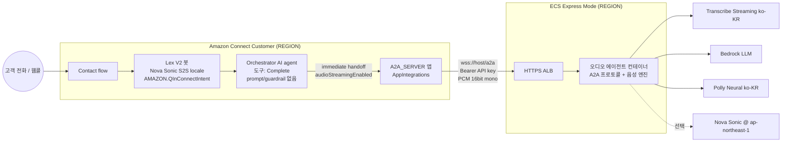

# 00. 개요: Connect Customer 음성 A2A (서울 / 싱가포르, Nova Sonic 우회형)

> 기준 워크숍: [Amazon Connect Customer Agent-to-Agent](https://catalog.us-east-1.prod.workshops.aws/workshops/402c3041-a944-4b14-835e-39bb482ab54e/en-US)의 "Audio handoff" / "Audio path"
> 작성일: 2026-11-19. `[검증]` 표시는 문서로 확정하지 못해 실제 구성 중 확인해야 하는 항목.

## 1. 목표

- Amazon Connect Customer 음성 통화를 **A2A 오디오 핸드오프**(`audioStreamingEnabled: true`)로 ECS 위의 내 에이전트에 넘긴다.
- Connect ↔ 에이전트 사이는 `wss://` 웹소켓 하나로 **PCM 음성을 양방향 그대로** 주고받는다.
- 에이전트는 **Bedrock Nova Sonic을 호출하지 않는다**(우회). 리전 안에서 쓸 수 있는 음성 엔진으로 직접 듣고 말한다.
- **서울(ap-northeast-2)과 싱가포르(ap-southeast-1)에 각각 독립적으로** 같은 구성을 올릴 수 있어야 한다.
- 언어: **서울 = 한국어(ko-KR), 싱가포르 = 인도네시아어(id-ID)**.

## 2. 전체 구조



핵심 포인트:
- Lex 봇 locale을 Nova Sonic S2S로 설정하는 건 **Connect 쪽 등록 조건**일 뿐이다. 오디오 스트리밍이 켜져 있으면 봇이 음성을 처리하지 않고, 음성은 Connect와 외부 에이전트 사이를 직접 오간다(공식 문서 "Quotas and limitations for agent-to-agent collaboration").
- 그래서 에이전트 안의 음성 엔진은 자유롭게 고를 수 있다. 워크숍 예제(Sofía)의 Nova Sonic 부분만 갈아 끼우면 된다.

## 3. 워크숍과 다른 점

| 항목 | 워크숍 | 이 설계 |
|---|---|---|
| 리전 | us-east-1 / us-west-2 | ap-northeast-2 / ap-southeast-1 각각 |
| 기반 리소스 | `event-stack` CloudFormation(비공개 템플릿)이 일괄 생성 | 직접 만드는 `a2a-voice-base` (문서 02, 03) |
| 에이전트 음성 엔진 | Bedrock Nova 2.5 Sonic | 우회: Transcribe + Bedrock LLM + Polly (한국어) |
| 언어 | en_US | ko-KR 목표 (`register.py`의 `en_US` 고정값 수정 필요) |
| 테스트 진입점 | 워크숍 Test page(CloudFront) | Connect 통신 위젯 웹콜 또는 전화번호 |
| 등록 스크립트 | `register.py` (event-stack 출력에 의존) | 포크한 `register_audio.py` (문서 06) |

## 4. 리전별 가능 여부 (2026-11-19 문서 기준)

| 구성요소 | 서울 | 싱가포르 | 비고 |
|---|---|---|---|
| Connect Customer 인스턴스 | O | O | Connect 리전 표 |
| A2A 협업(외부 에이전트) | O | O | "Connect Customer가 제공되는 리전" (2026-09 출시 노트) |
| AppIntegrations (A2A_SERVER) | O | O | 리전 표 |
| Connect AI agents (agent assist) | O | O | 리전 표 |
| Connect agentic voice / Nova Sonic S2S 봇 | O | O | 2026-04 서울·싱가포르 추가 |
| 웹/앱 통화 (통신 위젯) | O | O | 리전 표 |
| ECS Express Mode | O | O | ECS + Fargate 지원 리전 전체 |
| Transcribe Streaming | O | O | ko-KR 스트리밍 지원 |
| Polly Neural (Seoyeon, Jihye) | O | O | Neural 지원 리전 목록 |
| Bedrock LLM (Claude Haiku 4.5 / Nova 2 Lite 등) | `[검증]` | `[검증]` | 리전 내 또는 APAC/Global 추론 프로필 여부를 콘솔에서 확인 |
| **Bedrock Nova Sonic 직접 호출** | **X** | **X** | 지원 리전: us-east-1, us-west-2, eu-north-1, ap-northeast-1 |
| Nova Sonic 한국어/인도네시아어 | - | - | Nova 2.5 Sonic 공식 지원 언어에 둘 다 없음. 우회가 사실상 필수 |
| STT (Transcribe 스트리밍) | ko-KR O | **id-ID O** | Transcribe 지원 언어 표 |
| TTS (Polly) | ko-KR O (Seoyeon, Jihye, Hyunduk) | **id-ID X** | Polly에 인도네시아어 음성 없음. Lex 문서도 id_ID TTS는 외부(ElevenLabs)만 가능하다고 명시 |
| Connect AI agents / agentic voice | ko_KR O | id_ID O | Connect 지원 언어 표 (Connect 자체 STT/TTS는 인도네시아어 가능) |

**결론: 새로 만들어도 불가능한 구성요소는 없다.** Bedrock Nova Sonic 직접 호출만 두 리전 모두 안 되고, 우회 엔진으로 대체한다.
**Lex S2S locale 실측(2026-11-19, CreateBotLocale + `amazon.nova-2-sonic-v1:0`):** 서울 ko_KR O, id_ID X / 싱가포르 en_US O, id_ID X, ms_MY X / 시드니·캐나다 en_US O. Connect가 있어도 agentic voice 목록에 없는 리전(케이프타운, GovCloud)은 오디오 핸드오프 등록 조건을 맞출 수 없다(문서 기준, 미실측).

**단, 싱가포르(인도네시아어)는 AWS 관리형 TTS가 없어서** 에이전트 음성 합성을 따로 정해야 한다(D8).

## 5. 먼저 정할 것 (Decision log)

| ID | 결정 | 기본안(추천) | 대안 |
|---|---|---|---|
| D1 | 에이전트 음성 엔진 | `cascade-ko`: Transcribe → LLM → Polly | `nova-tokyo`(도쿄 호출, 영어 위주, 데이터 리전 이탈), 외부 실시간 S2S |
| D2 | 첫 검증 엔진 | `loopback` (AI 없이 프로토콜만 검증) | 바로 cascade |
| D3 | LLM 호출 방식 | 리전 내 모델 또는 `apac.` 프로필 | `global.` 프로필 (데이터가 아시아 밖으로 나갈 수 있음) |
| D4 | 등록 방식 | `register.py` 포크해서 의존성 제거 | event-stack 출력 이름을 흉내 내는 호환 스택 |
| D5 | 테스트 진입점 | 통신 위젯 웹콜 | 국내/싱가포르 전화번호(서류 요건 `[검증]`) |
| D6 | 네트워크 | 기본 VPC + 퍼블릭 서브넷 2개 AZ 이상 | 기존 VPC를 Express Mode `networkConfiguration`에 지정 `[검증]` |
| D7 | Lex 봇 locale | 서울 ko_KR (확인됨) / **싱가포르 en_US** | id_ID는 S2S 미지원(2026-11-19 API 확인: "Speech to Speech is not supported in locale id_ID"). 봇은 en_US, 에이전트가 인도네시아어로 응답 |
| D8 | 싱가포르 인도네시아어 TTS | ECS에서 직접 돌리는 오픈 TTS 모델(예: MMS-TTS `ind`, 리전 내 처리) `[검증: 품질, CPU 지연]` | 외부 TTS API(ElevenLabs 등, 데이터 AWS 밖) / 음성 그대로 전달을 포기하고 `handoff-text`로 Connect agentic voice(id_ID) 사용 |

## 6. 이름 규칙과 리전 설정

- 접두사: `a2a-voice-` (예: `a2a-voice-agent` 서비스, `a2a-voice-agent-key` 시크릿)
- 리전별 설정 파일: `config/ap-northeast-2.env`, `config/ap-southeast-1.env`
- 모든 스크립트는 `A2A_REGION` 하나로 리전을 바꾼다. 리전 이름을 코드에 직접 쓰지 않는다.

```bash
# config/ap-northeast-2.env (예시)
A2A_REGION=ap-northeast-2
A2A_LOCALE=ko_KR
A2A_STT_LANG=ko-KR
A2A_TTS_VOICE=Seoyeon
A2A_LLM_MODEL_ID=<검증 후 기입>
A2A_ENGINE=loopback   # loopback | cascade-ko | nova-tokyo
```

## 7. 문서 목록

| 문서 | 내용 |
|---|---|
| [01-protocol.md](01-protocol.md) | 오디오 핸드오프 메시지 규약 요약 |
| [02-region-foundation.md](02-region-foundation.md) | 리전 기반: 네트워크, IAM, KMS, 로그, ECR, CLI |
| [03-connect-setup.md](03-connect-setup.md) | Connect 인스턴스, AI agents, Lex 봇, 흐름, 테스트 채널 |
| [04-agent-design.md](04-agent-design.md) | 오디오 에이전트 설계 (우회 엔진) |
| [05-ecs-deploy.md](05-ecs-deploy.md) | ECS Express Mode 배포 |
| [06-register-and-test.md](06-register-and-test.md) | 테스터, Connect 등록, 통화, 트레이스 |
| [07-ops-and-cleanup.md](07-ops-and-cleanup.md) | 운영 준비, 싱가포르 복제, 정리 |

## 8. 참고 자료

- 워크숍 다운로드 (공개): `a2a-connect-setup.zip`, `a2a-starter-kit.zip`, `a2a-tester.zip`, `a2a-audio-bridge.zip`
  - `https://static.us-east-1.prod.workshops.aws/public/8286e7ea-b206-4073-b200-89a955a1c960/static/downloads/<파일명>`
- AWS 문서: Set up an external AI agent integration (`connect/latest/adminguide/a2a-setup-external.html`)
- AWS 문서: Quotas and limitations for agent-to-agent collaboration (`a2a-quotas.html`)
- AWS 문서: A2A protocol contract for external AI agents (`connect/latest/devguide/a2a-developer-guide.html`)
- AWS 문서: Availability of Connect Customer features by Region (`connect/latest/adminguide/regions.html`)
