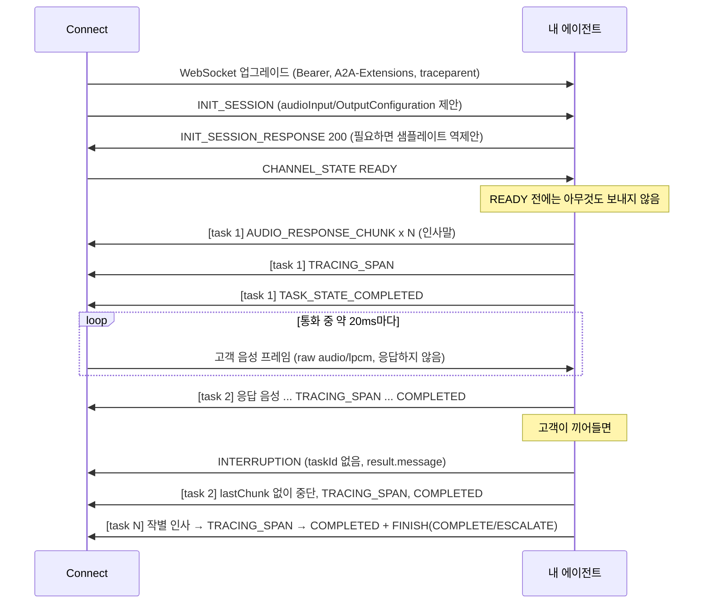

# 01. 오디오 핸드오프 프로토콜 요약

워크숍 "The message contract", "Audio path", "Message reference" 내용을 오디오 기준으로 정리했다.
규약은 **A2A v1.0 JSON-RPC 2.0** 위에 Connect 확장 `https://docs.aws.amazon.com/connect/a2a/ext/v1`을 더한 형태다.

## 1. 연결

| 항목 | 규칙 |
|---|---|
| URL | `wss://<host>/a2a` (오디오는 웹소켓만 가능, HTTPS JSON-RPC 불가) |
| 인증 | 업그레이드 요청마다 `Authorization: Bearer <key>`. 원문 키와 `{"apiKey":"<key>"}` 두 형태 모두 허용, 틀리면 401 |
| 확장 헤더 | 요청 헤더 `A2A-Extensions`를 업그레이드 응답에 그대로 돌려준다 |
| 트레이스 헤더 | `traceparent`에서 traceId, `tracestate`의 `connect=parentSpanId:<uuid>`에서 부모 span ID를 꺼내 보관 |
| 재시도 | 업그레이드가 502/503/504 또는 무응답이면 Connect가 1회 재시도. 401/403/429는 재시도 안 함 |
| 헬스체크 | `GET /health` → 200 (ALB용, Connect는 호출 안 함) |

## 2. 한 통화의 순서

## 3. 메시지별 체크포인트

### INIT_SESSION (Connect → 에이전트)
- `params.message.contextId` = 세션 ID. **상태는 연결이 아니라 contextId 기준으로 보관**한다(재연결 시 같은 값).
- `parts[0].data.initSession`: `instanceArn`, `contactArn`, `supportedFinishTypes`, `subscribeToTracingEvents`, `history`(즉시 핸드오프라 비어 있음), `contactContext`(보안 프로필에 Access Contact Control Panel 권한이 있을 때만)
- 오디오 통화일 때만 `audioInputConfiguration` / `audioOutputConfiguration` 포함

### INIT_SESSION_RESPONSE (에이전트 → Connect)
- 요청의 `id`를 그대로 사용, `result.message`, `role: ROLE_AGENT`, `statusCode: "200"`(문자열)
- 제안을 받아들이면 statusCode만 보낸다. 역제안할 때만 형식 전체를 다시 적는다.
  - `encoding: LINEAR_PCM`, `sampleRateHertz: 8000|16000|24000`, `sampleSizeBits: 16`, `channelCount: 1`
- **이 설계의 기본값**: 입력은 Connect 제안(보통 8kHz)을 그대로 받고, 출력은 16000Hz로 역제안한다(Polly `pcm`이 8000/16000만 지원).

### 고객 음성 프레임 (Connect → 에이전트)
- `parts: [{"raw": "<base64 PCM>", "mediaType": "audio/lpcm"}]`, `metadata: {}`, 이벤트 타입 없음
- 약 20ms 단위로 온다. 크기를 가정하지 말고 받은 대로 처리한다.
- **어떤 프레임에도 응답하지 않는다.**

### 응답 음성 (에이전트 → Connect)
- `result.artifactUpdate`, 이벤트 타입 `AUDIO_RESPONSE_CHUNK`, `parts: [{"raw": ..., "mediaType": "audio/lpcm"}]`
- 첫 청크는 `append:false`, 이후 `append:true`, 마지막은 `lastChunk:true`
- 청크 하나는 웹소켓 프레임 하나에 들어가는 크기(예: 100ms). **오디오는 FRAGMENT로 나누지 않는다.**
- **열린 오디오 artifact는 동시에 1개만.** 두 번째를 열면 프로토콜 위반으로 연결이 끊긴다.

### TRACING_SPAN (턴마다 정확히 1개)
- 응답 뒤, 종료 상태 앞에, 같은 taskId로 보낸다. 형식은 OTLP/JSON(`tracingSpan.otlp.resourceSpans`)이다.
- 루트 span은 `invoke_agent <agentName>`, kind 2. LLM 호출은 `chat <model>` span으로, 도구 호출은 `execute_tool <tool>` span으로 남긴다(kind 3).
- 루트 span의 `aws.connect.span.message` 이벤트에 입력(STT 결과)과 출력(에이전트가 말한 문장)을 넣는다.
- 오디오 통화에서는 **Connect가 텍스트를 전혀 보지 못하므로 이 trace가 유일한 대화 기록**이다.
- 필수 데이터가 빠지면 **Connect가 엔드포인트를 비활성화**한다.

### INTERRUPTION (오디오에서는 에이전트 → Connect)
- 끼어들기(barge-in) 감지는 에이전트 책임이다. 감지하면 `result.message`로 보내고, taskId는 넣지 않는다.
- Connect는 이걸 받으면 재생 버퍼를 비운다. 보내지 않으면 이미 보낸 음성이 계속 재생된다.
- 이어서 하는 일: 열린 artifact를 lastChunk 없이 멈추고 → 해당 턴 TRACING_SPAN → COMPLETED → 다음 답변은 새 task와 새 artifactId로 보낸다.

### FINISH (대화 종료)
- 마지막 턴의 종료 상태 `status.message`에 `finish: {type: COMPLETE|ESCALATE, reason}`을 담는다.
- 작별 인사가 다 재생된 뒤 보낸다(Sofía는 최대 4초 대기). 그 뒤에는 아무것도 보내지 않는다.
- 연결을 1000으로 닫는 건 FINISH가 아니다. 결과 없이 협업이 끝난다.

### 오류
- 턴 실패: TRACING_SPAN → `TASK_STATE_FAILED` + `error{errorCode, errorReason, errorCategory}`. **협업 전체가 끝나고** 흐름이 Error 분기로 간다.
- Connect가 보내는 ERROR(예: 408 idle)는 진단용이다. 기록만 하고 응답하지 않는다.

## 4. 끊김을 막는 규칙 (가장 흔한 실패 원인)

1. **음성이 끊기지 않게 유지한다.** task나 artifact가 열린 채로 음성이 안 나가면 재생이 비고(underrun) Connect가 연결을 끊는다. 3초 동안 나간 음성이 없으면 100ms 무음을 열린 artifact에 이어 붙인다. artifact가 없으면 1청크짜리 artifact로 보낸다(`append:false`, `lastChunk:true`).
2. **배포 중 재시작할 때는 코드 1012로 닫는다.** Connect가 같은 contextId로 1회 재연결한다.
3. **턴(task)은 한 번에 하나만 연다.**

## 5. 오디오 핸드오프 등록 조건

`register.py`의 `audio_violations()`와 공식 문서 기준이다.

- [ ] AccessUrl이 `wss://`로 시작
- [ ] 협업자는 이 외부 에이전트 하나뿐
- [ ] `handoffAgentConfiguration`에 `audioStreamingEnabled: true`, `immediateHandoff: true`
- [ ] orchestrator에 orchestration prompt와 guardrail이 없음
- [ ] orchestrator 도구는 `Complete` 하나. 흐름에 상담원 큐가 없어서 `Escalate`는 두지 않는다. 에이전트는 Connect에 항상 FINISH COMPLETE를 보낸다
- [ ] 흐름이 Nova Sonic S2S locale과 단일 `AMAZON.QInConnectIntent`를 가진 Lex 봇을 사용
- [ ] 인스턴스는 Customer 티어 (Customer Basic 불가)
