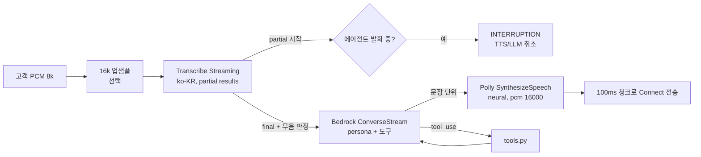

# 04. 오디오 에이전트 설계 (Nova Sonic 우회형)

> 출발점은 워크숍 `a2a-audio-bridge` (Sofía)다. 프로토콜 처리부(`server.py`, `a2a.py`, `tracing.py`, `bearer.py`)는 그대로 가져온다.
> 음성 엔진(`nova.py`) 자리에 **엔진 인터페이스**를 두고 구현체를 바꿔 끼운다.
> Sofía에 이미 `stubnova.py`(Nova 대체 가짜 엔진)가 있어서 교체 지점이 분명하다.

## 4.1 모듈 구조

```
agent/
  server.py        # 워크숍 server.py 기반: 세션 상태 머신, bearer, INIT/READY, 턴=task, 끼어들기, keepalive, FINISH
  a2a.py           # 메시지 생성기 (워크숍 그대로)
  tracing.py       # 턴당 TRACING_SPAN (invoke_agent / chat / execute_tool)
  bearer.py        # 상수 시간 비교, raw와 {"apiKey"} 둘 다 허용
  secrets.py       # Secrets Manager 지연 로딩
  audio.py         # 리샘플링(8k↔16k), 100ms 프레이밍
  config.py        # 환경변수: A2A_REGION, A2A_ENGINE, A2A_STT_LANG, A2A_TTS_VOICE, A2A_LLM_MODEL_ID ...
  engines/
    base.py        # SpeechEngine 인터페이스
    loopback.py    # D2: AI 없이 프로토콜 검증용
    cascade.py     # D1 기본: Transcribe → Bedrock → Polly
    nova_tokyo.py  # 선택: 워크숍 nova.py + NOVA_REGION=ap-northeast-1
  tools.py         # 업무 도구(조회 등) + end_call(COMPLETE/ESCALATE)
  persona_ko.txt   # 시스템 프롬프트
  Dockerfile
```

## 4.2 엔진 인터페이스

server.py는 엔진을 몰라도 되도록 **이벤트 기반**으로 정의한다.

```python
class SpeechEngine(Protocol):
    async def start(self, session: SessionInfo) -> None: ...        # READY 수신 시
    async def push_audio(self, pcm16: bytes, rate: int) -> None: ...  # 고객 음성 프레임
    async def stop(self) -> None: ...
    def events(self) -> AsyncIterator[EngineEvent]: ...

# EngineEvent 종류
#  UserSpeechStarted          -> server: 말하는 중이면 INTERRUPTION 처리
#  UserTranscript(text, final)
#  AgentTurnStart(turn_id)    -> server: 새 task 열기
#  AgentAudio(pcm16, rate)    -> server: 열린 artifact에 100ms 단위로 append
#  AgentText(text)            -> trace 출력 메시지에 누적
#  ToolCall(name, input) / ToolResult(name, output)  -> execute_tool span
#  LlmCall(model, usage, t0, t1)                     -> chat span
#  AgentTurnEnd(turn_id)      -> server: lastChunk → TRACING_SPAN → COMPLETED
#  Finish(type, reason)       -> server: 재생 완료 대기 후 FINISH
```

server.py가 지키는 불변식은 다음과 같다(엔진과 무관).
- READY 전에는 출력하지 않는다.
- task와 오디오 artifact는 동시에 1개만 연다.
- 3초 동안 나간 음성이 없으면 100ms 무음을 보낸다.
- 턴마다 TRACING_SPAN을 정확히 1개 보낸다.
- FINISH 뒤에는 아무것도 보내지 않는다.
- SIGTERM을 받으면 1012로 닫는다.

## 4.3 엔진 A: `loopback` (1차 목표)

목적: **AI 없이** Connect ↔ ECS 음성 경로, 형식 협상, 끼어들기, keepalive, FINISH를 먼저 검증한다.

동작:
1. READY를 받으면 미리 녹음한 인사말 PCM(16kHz)을 재생한다: "테스트 에이전트입니다. 말씀하시면 그대로 따라 할게요."
2. 간단한 에너지 기반 VAD로 발화 시작과 끝(무음 700ms)을 판단한다.
3. 발화가 끝나면 받은 음성을 그대로 되돌려 재생한다(에코).
4. 에코 재생 중 새 발화가 시작되면 INTERRUPTION을 보낸다.
5. 키패드 입력(DTMF) `#` 또는 3번째 턴에서 작별 멘트를 재생하고 FINISH COMPLETE를 보낸다. `*`이면 ESCALATE를 보낸다.
6. trace 입력과 출력에는 `"[audio 1.8s]"`처럼 길이 정보만 넣는다(필수 이벤트 형식은 지킨다).

> 이 단계에서 tester `--suite all`(오디오 포함)과 실제 Connect 통화가 통과하면 엔진 교체만 남는다.

## 4.4 엔진 B: `cascade-ko` (기본 엔진)



| 단계 | 서비스/설정 | 메모 |
|---|---|---|
| STT | Transcribe Streaming, `LanguageCode=ko-KR`, `MediaEncoding=pcm`, `MediaSampleRateHertz=8000` 또는 16000 | 통화 전체에 스트림 1개. partial 결과로 끼어들기 감지 |
| 턴 종료 판정 | final segment + 무음 600~800ms 타이머 | 너무 짧으면 말을 자르고, 너무 길면 느려진다. 조정 대상 |
| LLM | Bedrock ConverseStream, `A2A_LLM_MODEL_ID` | 토큰을 스트리밍해서 문장 단위로 끊어 TTS로 넘긴다. `[검증]` 리전별 모델 |
| TTS | Polly `Engine=neural`, `VoiceId=Seoyeon` 또는 `Jihye`, `OutputFormat=pcm`, `SampleRate=16000` | 문장마다 호출해서 첫 음성까지의 지연을 줄인다 |
| 출력 형식 | INIT_SESSION_RESPONSE에서 출력 16000Hz 역제안 | Polly pcm은 8000/16000만 지원 |
| 끼어들기 | 에이전트 발화 중 Transcribe partial 텍스트 2글자 이상 또는 VAD 300ms 이상 | INTERRUPTION 전송 → LLM 스트림과 TTS 취소 → 턴 마감 |
| 도구 대기 | 도구 실행 중에는 keepalive 무음, 필요하면 "잠시만요" 같은 필러 음성 | 언더런 방지 |
| 종료 | `end_call` 도구(COMPLETE/ESCALATE + reason) | Connect에는 항상 FINISH COMPLETE를 보낸다. ESCALATE면 TMS에 콜백 요청을 남긴다(아래) |

**지연 목표(가정치, 측정으로 확정):** 고객 발화 끝 → 첫 음성까지 1.5초 이내
= 턴 종료 판정(~0.7s) + LLM 첫 토큰(~0.5s) + Polly 첫 바이트(~0.2s)

**trace 매핑:**
- 루트 `invoke_agent a2a-voice-agent`: 입력 = Transcribe final 텍스트, 출력 = 실제로 말한 문장(끼어들기 시 재생된 부분까지)
- `chat <model>`: LLM 호출마다 하나씩, 토큰 사용량 포함
- `execute_tool <name>`: 입력과 결과를 반드시 포함(빠지면 엔드포인트가 비활성화됨)

### 4.4.1 구현 결과 (2026-11-19, 이미지 v5)

| 항목 | 구현 | 파일 |
|---|---|---|
| STT | Transcribe Streaming WebSocket을 aiohttp + botocore SigV4 presign + event-stream 직접 인코딩으로 연결. 새 의존성 없음. `enable-partial-results-stabilization=high` | `bridge/engines/transcribe_ws.py` |
| 턴 종료 | final 결과 + 150ms(`A2A_TURN_END_MS`), 그 사이 partial이 오거나 VAD가 아직 발화 중이면 연기 | `cascade.py` `_end_of_utterance` |
| LLM | `apac.amazon.nova-lite-v1:0` ConverseStream, **temperature 0 + topK 1** (0.3에서는 다중 턴 뒤 end_call ESCALATE를 건너뛴 사례가 있었음). `<thinking>` 태그 제거 | `cascade.py` `_llm_round` |
| 문장 분할 | `. ? ! ~` 기준, **첫 조각만 쉼표에서도 끊어** 첫 음성을 앞당김 | `SentenceSplitter` |
| TTS | Polly neural Seoyeon pcm 16k, 응답 스트림을 100ms 단위로 읽어 바로 전송 | `cascade.py` `_speak` |
| 끼어들기 | 에이전트 재생/생성 중 partial 2글자 이상 또는 VAD 400ms → INTERRUPTION, LLM/TTS 취소, 오디오 블록 INTERRUPTED 종료. 말하지 못한 답이면 고객 발화를 다음 턴에 합침 | `_barge_in` |
| 종료 | `end_call` 도구 → server.py LocalTools → FINISH COMPLETE. ESCALATE면 작별 음성 재생과 동시에 TMS 콜백 요청을 보낸다. 모델이 말없이 도구만 부르면 기본 작별/콜백 멘트 재생 | `_respond`, `local_tools.py` |
| 콜백 요청 | `A2A_TMS_URL`에 JSON POST `{contactId, phone, reason, summary}`. 1.5초 타임아웃으로 2회 시도. 실패하거나 URL이 비어 있으면 `CALLBACK_NOT_FILED <요청 본문>`을 ERROR로 남긴다(복구용). `phone`은 `DescribeContact`의 `CustomerEndpoint.Address`이고 웹콜이면 null. `A2A_TMS_URL=mock`이면 TMS 대신 0.5초 뒤 `{"status": "received"}`로 응답하는 목(mock)을 쓴다(실제 TMS가 정해지기 전까지). 인증 헤더는 TMS API가 정해지면 추가 | `local_tools.py` `_request_callback` |
| 무응답 | 25초 무발화 시 "여보세요" 1회, 50초면 작별 후 COMPLETE | `_idle_watchdog` |
| 설정 | `A2A_ENGINE=cascade`, `A2A_LLM_MODEL_ID`, `A2A_LLM_TEMPERATURE`, `A2A_LLM_TOP_K`, `A2A_TURN_END_MS`, `A2A_BARGE_IN_CHARS`, `A2A_BARGE_IN_VAD_MS`, `A2A_GREETING`, `A2A_PERSONA_PATH`(기본 `persona_ko.txt`) | `config.py` |

**Bedrock 후보 측정 (서울, 첫 토큰):** apac Nova Lite 0.32~0.46s, apac Nova Micro 0.37s, global Nova 2 Lite 0.97s, global Claude Haiku 4.5 0.73s(이후 "use case details not submitted"로 거부), Haiku 5.5 계정 미허용, apac Claude 3.5 Sonnet v2 EOL.

**지연 측정 (CloudShell → 에이전트, Polly 합성 음성 고객):**

| 구간 | 값 |
|---|---|
| 고객 발화 끝 → Transcribe final | 약 0.65s |
| 턴 종료 타이머 | 0.15s |
| 턴 종료 → LLM 첫 토큰 | 0.31~0.37s |
| 턴 종료 → 첫 음성 전송 | 0.44~1.1s |
| **고객 발화 끝 → 첫 음성 (클라이언트 측정, 배포 v5)** | **1.09~1.68s** (튜닝 전 2.1~2.3s) |

남은 개선안: VAD 무음 350ms 시점에 안정화된 partial로 LLM을 추측 시작하고 final이 같으면 그대로 쓰기(약 0.3s 단축 예상).

**페르소나 교훈:** "해결할 수 없는 요청이면 ESCALATE" 문구는 greedy 디코딩에서 일반 질문(장소 추천)까지 ESCALATE로 보냈다. ESCALATE는 명시적 상담원 요청일 때만 하도록 좁히고, `<thinking>` 없이 바로 말하도록 지시하자 도구 판단 14/14, 첫 노출 토큰 0.3~0.5s가 됐다.

**검증:** `tests/live_cascade_client.py`(질문 2회, 끼어들기, 종료)로 로컬과 배포 환경 모두 통과. FINISH COMPLETE(작별)와 FINISH ESCALATE(상담원 요청, reason 포함) 확인. TRACING_SPAN에 chat span, end_call 턴에 execute_tool span 포함.

## 4.5 엔진 C: `nova-tokyo` (선택)

- 워크숍 `nova.py`를 그대로 쓰고 `NOVA_REGION=ap-northeast-1`만 지정한다.
- 장점: Sofía 코드를 거의 그대로 재사용한다. 끼어들기와 턴 판정을 모델이 해 준다.
- 단점:
  - 음성 데이터가 리전 밖(도쿄)으로 나간다.
  - 서울/싱가포르 → 도쿄 왕복 지연이 생긴다.
  - **Nova 2.5 Sonic은 한국어를 공식 지원하지 않는다**(영어, 스페인어, 독일어, 프랑스어, 이탈리아어, 포르투갈어, 힌디어만 지원).
- 쓸 곳: 영어 데모나 비교 측정용.

## 4.6 세션과 확장성

- 상태는 `contextId`로 보관한다. 재연결(1012)되면 같은 contextId로 새 INIT_SESSION이 오므로, 엔진 상태를 이어받거나 짧게 다시 인사한다.
- 통화 1건 = 웹소켓 1개 = 엔진 스트림 1세트. 1 vCPU / 2GB 태스크로 시작하고, 동시 통화 수를 측정해 오토스케일 기준을 정한다.
- Connect 쪽 동시 연결 한도는 인스턴스당 5개(기본값)다. 부하 테스트 전에 상향 요청한다.

## 4.7 로컬 개발 루프

```bash
# 1) 워크숍 다운로드 압축 해제 (reference/ 에 이미 있음)
# 2) 로컬 실행 (ws:// 는 localhost 에서만 tester 가 허용)
export A2A_API_KEY=local-practice-key A2A_ENGINE=loopback
python -m agent.server --host 127.0.0.1 --port 8080
# 3) 적합성 테스트
cd reference/a2a-tester && python3 -m a2a_tester --url ws://127.0.0.1:8080/a2a --key-env A2A_API_KEY --suite core
python3 -m a2a_tester --url ws://127.0.0.1:8080/a2a --key-env A2A_API_KEY --suite all   # 오디오/끼어들기/무음 포함
```

> 워크숍 다운로드 4종(`a2a-connect-setup`, `a2a-audio-bridge`, `a2a-starter-kit`, `a2a-tester`)은 `reference/`에 풀어 두었다(2026-11-19 받음, MIT-0).

## 완료 기준
- [ ] `loopback`으로 tester core와 all 통과 (exit 0)
- [ ] `cascade-ko`로 로컬 WAV 재생 테스트에서 한국어 대화 1회 이상 성공
- [ ] trace에 입력/출력/도구 정보가 모두 들어감 (TRACE-* 통과)
