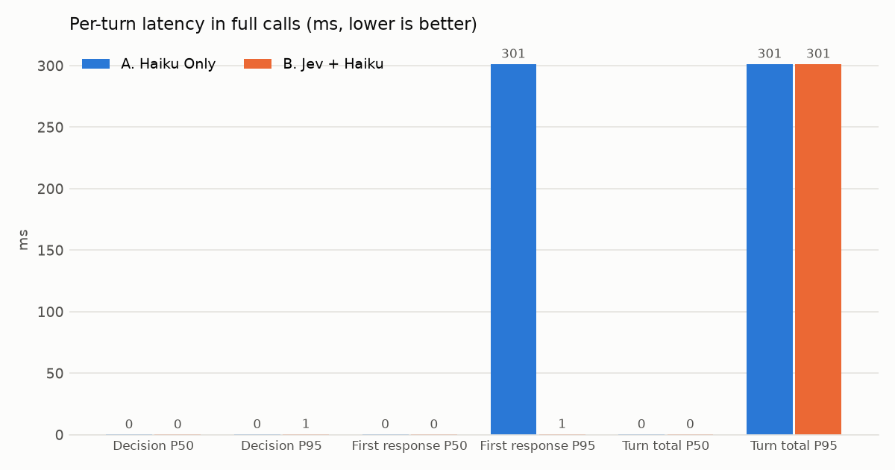
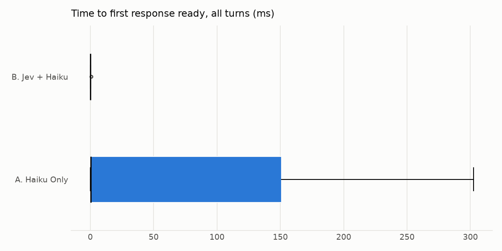
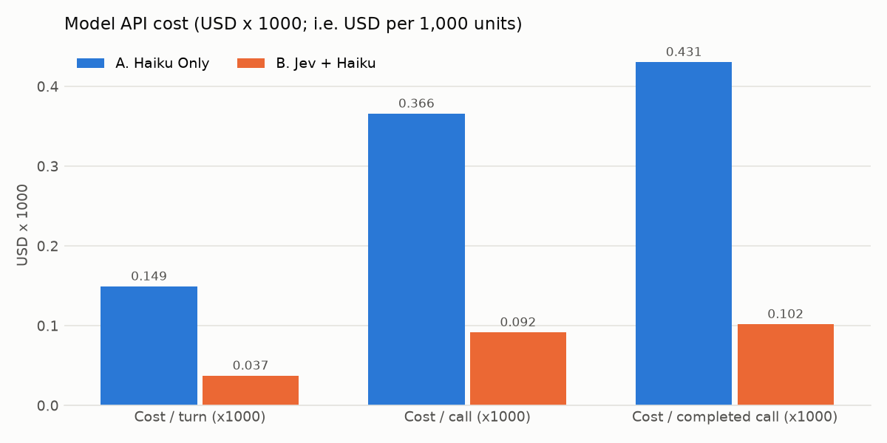
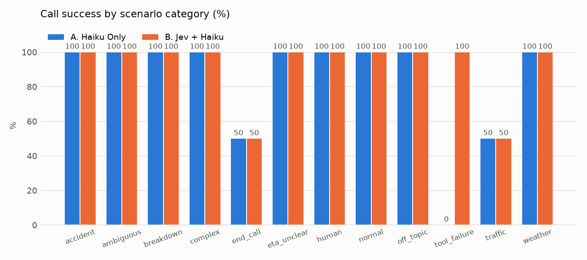
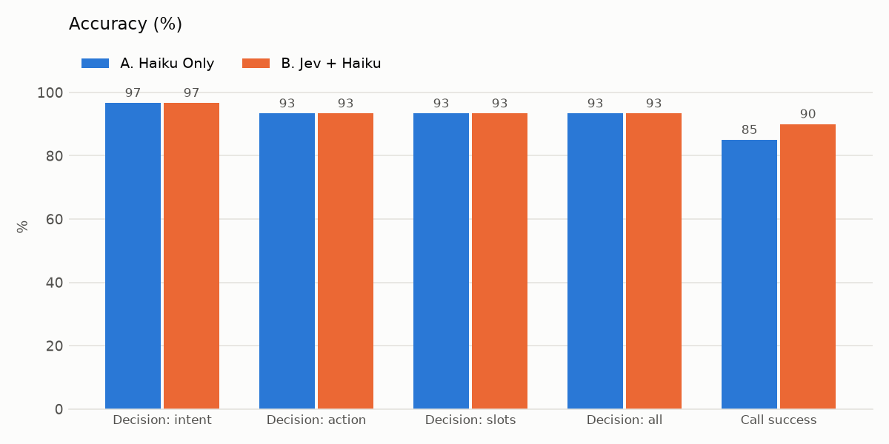
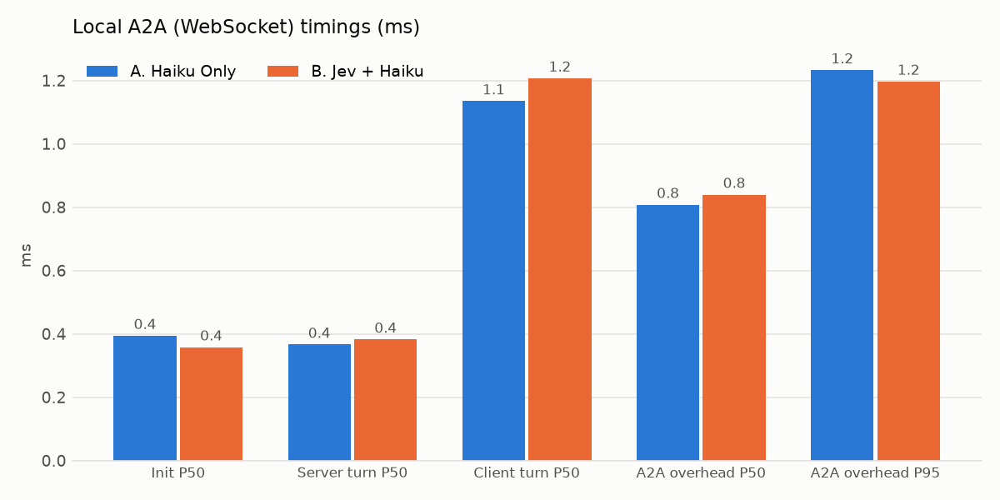

# Benchmark report — 20261117-182514-mock

> **MOCK RUN** — offline stand-in models. Numbers below are NOT model performance.

- Mode: **mock**, reps: 2, seed: 20261117, concurrency: 4
- Haiku: `anthropic/claude-haiku-5.5` (reasoning=none); Jev: `typesafe/jev-1.14`, threshold 0.8
- TMS mock latency: 150 ms; spent: $0.0288; 2026-11-17 18:25:14 +0900 → 2026-11-17 18:25:20 +0900

## 1. Pure decision benchmark (engine + rule engine, no tools, no adapter)

| Metric | A. Haiku Only | B. Jev + Haiku |
|---|---:|---:|
| Decisions (n) | 60 | 60 |
| Errors | 0 | 0 |
| Accuracy (intent+action+slots) | 93.3% | 93.3% |
| Intent accuracy | 96.7% | 96.7% |
| Action accuracy | 93.3% | 93.3% |
| Slot accuracy | 93.3% | 93.3% |
| Decision time P50 / P95 (ms) | 0 / 0 | 0 / 1 |
| Decision time P50, no fallback (ms) | 0 | 0 |
| Decision time P50, with fallback (ms) | – | 0 |
| Time to first token P50 (ms) | 0 | 0 |
| Fallback rate | – | 20.0% |
| Accuracy without / with fallback | 93.3% / – | 100.0% / 66.7% |
| Input / output tokens per decision | 900 / 80 | 630 / 16 |
| Cost per decision | $0.0001300 | $0.0000449 |
| API calls by model | mock/haiku: 60 | mock/jev: 60, mock/haiku: 12 |

Fallback reasons (B): {'off_topic': 6, 'multiple_time_expressions': 2, 'low_confidence_intent': 4}

Accuracy by category:

| Category | A | B |
|---|---:|---:|
| accident | 100.0% | 100.0% |
| ambiguous | 100.0% | 100.0% |
| breakdown | 100.0% | 100.0% |
| complex | 0.0% | 0.0% |
| end_call | 100.0% | 100.0% |
| eta_unclear | 100.0% | 100.0% |
| human | 100.0% | 100.0% |
| normal | 100.0% | 100.0% |
| off_topic | 100.0% | 100.0% |
| traffic | 75.0% | 75.0% |
| weather | 100.0% | 100.0% |

Incorrect decisions — A. Haiku Only (case, text, intent, action, slots):

- d12 `도착까지 40분이고요, 상차 대기 때문에 이미 15분 정도 늦어졌어요` → provide_info, ASK_DELAY, {"eta_minutes": 40, "issue": "other", "delay_minutes": null}
- d15 `고속도로가 많이 막히네요` → ambiguous, CLARIFY, {"eta_minutes": 40, "issue": null, "delay_minutes": null}

Incorrect decisions — B. Jev + Haiku (case, text, intent, action, slots):

- d12 `도착까지 40분이고요, 상차 대기 때문에 이미 15분 정도 늦어졌어요` → provide_info, ASK_DELAY, {"eta_minutes": 40, "issue": "other", "delay_minutes": null}
- d15 `고속도로가 많이 막히네요` → ambiguous, CLARIFY, {"eta_minutes": 40, "issue": null, "delay_minutes": null}

## 2. Full conversation benchmark (direct orchestrator calls)

| Metric | A. Haiku Only | B. Jev + Haiku |
|---|---:|---:|
| Calls / turns | 40 / 98 | 40 / 98 |
| Call success (outcome + slots + TMS) | 85.0% | 90.0% |
| Outcome correct | 95.0% | 95.0% |
| Slots correct | 95.0% | 95.0% |
| Wrong terminations | 2 | 2 |
| Stuck (max turns) | 0 | 0 |
| Re-asks per call | 0.40 | 0.40 |
| Turns per call | 2.45 | 2.45 |
| Intent accuracy (per turn) | 93.9% | 93.9% |
| TMS failure reported correctly | 0.0% | 100.0% |
| Model decision P50 / P95 (ms) | 0 / 0 | 0 / 1 |
| Time to first token P50 (ms) | 0 | 0 |
| **First response ready P50 / P95 (ms)** | **0 / 301** | **0 / 1** |
| First response ready on tool turns P50 (ms) | 151 | 0 |
| Turn total P50 / P95 (ms) | 0 / 301 | 0 / 301 |
| Tool (TMS) time P50 (ms) | 150 | 151 |
| Scenario completion P50 / P95 (ms, agent time only) | 152 / 303 | 152 / 302 |
| Fallback rate (turns) | – | 14.3% |
| Model errors | 0 | 0 |
| API calls per call, by model | mock/haiku: 3.40 | mock/jev: 2.45, mock/haiku: 0.35 |
| Input / output tokens per call | 2490 / 224 | 1418 / 28 |
| Cost per turn | $0.0001494 | $0.0000375 |
| Cost per call | $0.000366 | $0.000092 |
| Cost per completed call | $0.000431 | $0.000102 |
| Cost for 1,000 calls | $0.366 | $0.092 |
| Cost for 10,000 calls | $3.66 | $0.92 |
| Share of cost from provider-reported usage | 0.0% | 0.0% |

Fallback reasons (B): {'off_topic': 4, 'multiple_time_expressions': 2, 'low_confidence_intent': 8}

Success by scenario:

| Scenario | A | B |
|---|---:|---:|
| c01 | 100.0% | 100.0% |
| c02 | 100.0% | 100.0% |
| c03 | 100.0% | 100.0% |
| c04 | 0.0% | 0.0% |
| c05 | 100.0% | 100.0% |
| c06 | 100.0% | 100.0% |
| c07 | 100.0% | 100.0% |
| c08 | 100.0% | 100.0% |
| c09 | 100.0% | 100.0% |
| c10 | 100.0% | 100.0% |
| c11 | 100.0% | 100.0% |
| c12 | 100.0% | 100.0% |
| c13 | 100.0% | 100.0% |
| c14 | 100.0% | 100.0% |
| c15 | 100.0% | 100.0% |
| c16 | 0.0% | 0.0% |
| c17 | 100.0% | 100.0% |
| c18 | 100.0% | 100.0% |
| c19 | 100.0% | 100.0% |
| c20 | 0.0% | 100.0% |

Failed calls — A. Haiku Only (first 6):

- **c04** outcome=ESCALATE slots={"eta_minutes": 50, "issue": null, "delay_minutes": null}
  - `50분이요` → ASK_ISSUE: 네, 확인했습니다. 다음 내용을 여쭤봐도 될까요?
  - `고속도로가 많이 막히네요` → CLARIFY: 네, 확인했습니다. 다음 내용을 여쭤봐도 될까요?
  - `고속도로가 많이 막히네요` → CLARIFY: 네, 확인했습니다. 다음 내용을 여쭤봐도 될까요?
  - `고속도로가 많이 막히네요` → ESCALATE: 확인 감사합니다. 처리했습니다. 안전 운행하세요.
- **c16** outcome=END_CALL slots={"eta_minutes": null, "issue": null, "delay_minutes": null}
  - `지금 운전 중이라 통화 어려워요, 끊을게요` → END_CALL: 알겠습니다. 확인된 내용까지만 등록해 두겠습니다. 안전 운행하세요.
- **c20** outcome=COMPLETE slots={"eta_minutes": 30, "issue": "none", "delay_minutes": null}
  - `20분에서 30분 사이요` → ASK_ISSUE: 네, 확인했습니다. 다음 내용을 여쭤봐도 될까요?
  - `순조롭게 잘 가고 있습니다` → COMPLETE: 확인 감사합니다. 처리했습니다. 안전 운행하세요.
- **c20** outcome=COMPLETE slots={"eta_minutes": 30, "issue": "none", "delay_minutes": null}
  - `20분에서 30분 사이요` → ASK_ISSUE: 네, 확인했습니다. 다음 내용을 여쭤봐도 될까요?
  - `순조롭게 잘 가고 있습니다` → COMPLETE: 확인 감사합니다. 처리했습니다. 안전 운행하세요.
- **c04** outcome=ESCALATE slots={"eta_minutes": 50, "issue": null, "delay_minutes": null}
  - `50분이요` → ASK_ISSUE: 네, 확인했습니다. 다음 내용을 여쭤봐도 될까요?
  - `고속도로가 많이 막히네요` → CLARIFY: 네, 확인했습니다. 다음 내용을 여쭤봐도 될까요?
  - `고속도로가 많이 막히네요` → CLARIFY: 네, 확인했습니다. 다음 내용을 여쭤봐도 될까요?
  - `고속도로가 많이 막히네요` → ESCALATE: 확인 감사합니다. 처리했습니다. 안전 운행하세요.
- **c16** outcome=END_CALL slots={"eta_minutes": null, "issue": null, "delay_minutes": null}
  - `지금 운전 중이라 통화 어려워요, 끊을게요` → END_CALL: 알겠습니다. 확인된 내용까지만 등록해 두겠습니다. 안전 운행하세요.

Failed calls — B. Jev + Haiku (first 4):

- **c04** outcome=ESCALATE slots={"eta_minutes": 50, "issue": null, "delay_minutes": null}
  - `50분이요` → ASK_ISSUE: 네, 50분 후 도착 예정으로 확인했습니다. 운행 중 특이사항은 없으신가요?
  - `고속도로가 많이 막히네요` → CLARIFY: 네, 확인했습니다. 다음 내용을 여쭤봐도 될까요?
  - `고속도로가 많이 막히네요` → CLARIFY: 네, 확인했습니다. 다음 내용을 여쭤봐도 될까요?
  - `고속도로가 많이 막히네요` → ESCALATE: 담당자에게 바로 연결해 드리겠습니다. 잠시만 기다려 주세요.
- **c04** outcome=ESCALATE slots={"eta_minutes": 50, "issue": null, "delay_minutes": null}
  - `50분이요` → ASK_ISSUE: 네, 50분 후 도착 예정으로 확인했습니다. 운행 중 특이사항은 없으신가요?
  - `고속도로가 많이 막히네요` → CLARIFY: 네, 확인했습니다. 다음 내용을 여쭤봐도 될까요?
  - `고속도로가 많이 막히네요` → CLARIFY: 네, 확인했습니다. 다음 내용을 여쭤봐도 될까요?
  - `고속도로가 많이 막히네요` → ESCALATE: 담당자에게 바로 연결해 드리겠습니다. 잠시만 기다려 주세요.
- **c16** outcome=END_CALL slots={"eta_minutes": null, "issue": null, "delay_minutes": null}
  - `지금 운전 중이라 통화 어려워요, 끊을게요` → END_CALL: 알겠습니다. 확인된 내용까지만 등록해 두겠습니다. 안전 운행하세요.
- **c16** outcome=END_CALL slots={"eta_minutes": null, "issue": null, "delay_minutes": null}
  - `지금 운전 중이라 통화 어려워요, 끊을게요` → END_CALL: 알겠습니다. 확인된 내용까지만 등록해 두겠습니다. 안전 운행하세요.

Costs are model API only (OpenRouter). Amazon Connect, STT/TTS, telephony and hosting are excluded — see docs/cost-model.md.

## 3. A2A adapter vs direct (local WebSocket, mock Connect client)

| Metric | A. Haiku Only | B. Jev + Haiku |
|---|---:|---:|
| Calls / turns | 6 / 16 | 6 / 16 |
| Protocol violations | 0 | 0 |
| Turns with TRACING_SPAN | 100.0% | 100.0% |
| FINISH type correct | 83.3% | 83.3% |
| WS connect P50 (ms) | 1 | 1 |
| INIT_SESSION → response P50 (ms) | 0.39 | 0.36 |
| First chunk at client P50 (ms) | 1 | 1 |
| Turn at client P50 / P95 (ms) | 1 / 302 | 1 / 302 |
| Turn inside server P50 (ms) | 0 | 0 |
| A2A overhead P50 / P95 (ms) | 0.8 / 1.2 | 0.8 / 1.2 |
| Direct (same scenarios) turn total P50 (ms) | 0 | 0 |

Overhead = client-observed turn time − server root span (`invoke_agent`) duration: JSON-RPC framing, trace serialization and loopback transport. Real Connect adds WAN latency and Connect-side processing that only a Phase 2 test in AWS can measure.

## Charts

