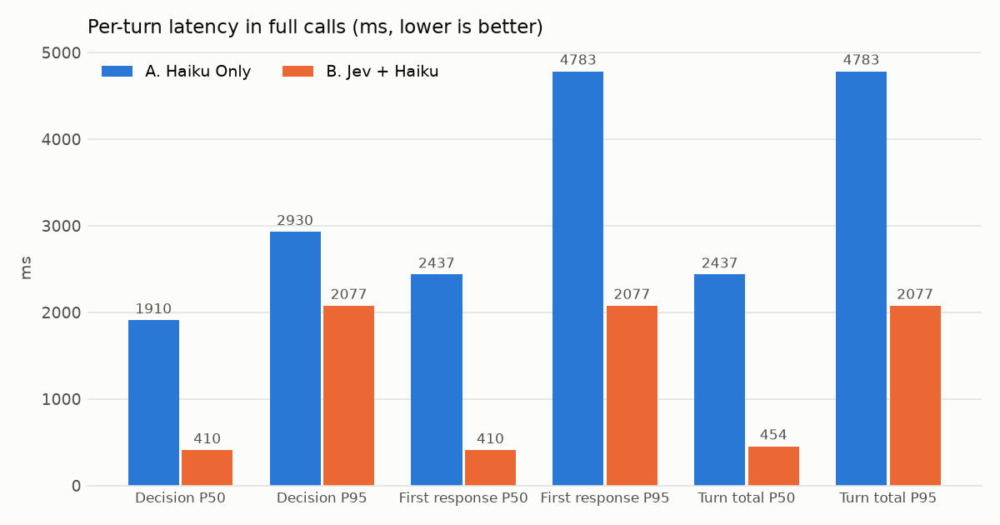
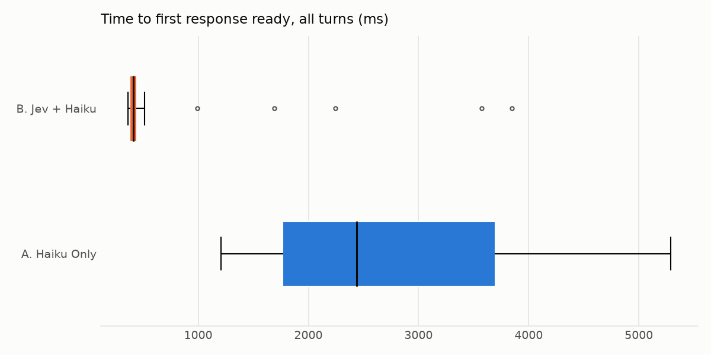
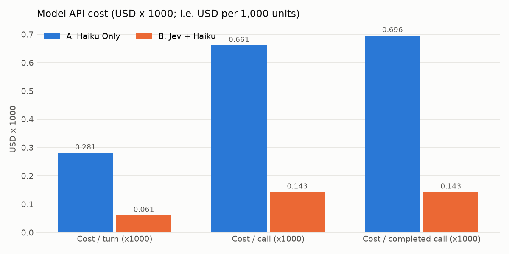
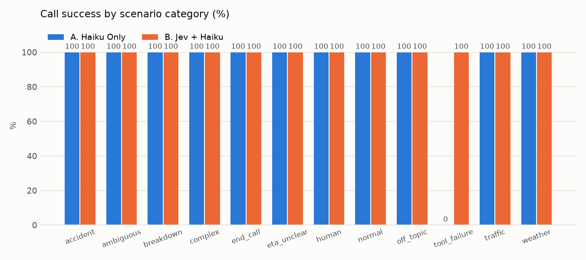
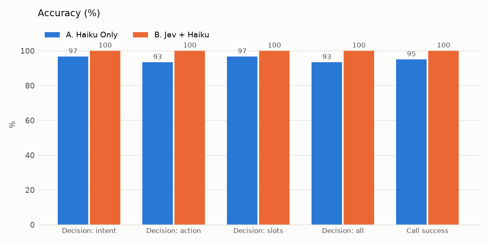
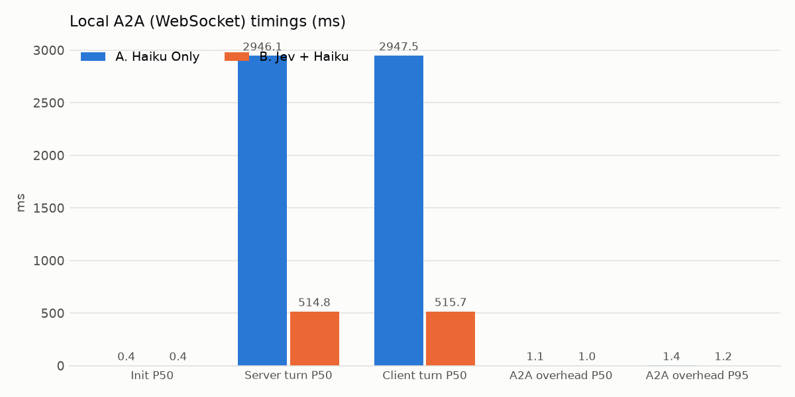

# Benchmark report — 20261117-183419

- Mode: **live**, reps: 1, seed: 20261117, concurrency: 4
- Haiku: `anthropic/claude-haiku-5.5` (reasoning=none); Jev: `typesafe/jev-1.14`, threshold 0.8
- TMS mock latency: 150 ms; spent: $0.0254; 2026-11-17 18:34:19 +0900 → 2026-11-17 18:36:16 +0900

## 1. Pure decision benchmark (engine + rule engine, no tools, no adapter)

| Metric | A. Haiku Only | B. Jev + Haiku |
|---|---:|---:|
| Decisions (n) | 30 | 30 |
| Errors | 0 | 0 |
| Accuracy (intent+action+slots) | 93.3% | 100.0% |
| Intent accuracy | 96.7% | 100.0% |
| Action accuracy | 93.3% | 100.0% |
| Slot accuracy | 96.7% | 100.0% |
| Decision time P50 / P95 (ms) | 1,768 / 2,623 | 446 / 2,187 |
| Decision time P50, no fallback (ms) | 1,768 | 441 |
| Decision time P50, with fallback (ms) | – | 2,039 |
| Time to first token P50 (ms) | 1,344 | 446 |
| Fallback rate | – | 16.7% |
| Accuracy without / with fallback | 93.3% / – | 100.0% / 100.0% |
| Input / output tokens per decision | 1691 / 121 | 1256 / 162 |
| Cost per decision | $0.0002295 | $0.0000798 |
| API calls by model | anthropic/claude-haiku-5.5: 30 | typesafe/jev-1.14-20261014: 30, anthropic/claude-haiku-5.5: 5 |

Fallback reasons (B): {'off_topic': 2, 'low_confidence_intent': 2, 'multiple_time_expressions': 1}

Accuracy by category:

| Category | A | B |
|---|---:|---:|
| accident | 0.0% | 100.0% |
| ambiguous | 100.0% | 100.0% |
| breakdown | 100.0% | 100.0% |
| complex | 100.0% | 100.0% |
| end_call | 100.0% | 100.0% |
| eta_unclear | 100.0% | 100.0% |
| human | 100.0% | 100.0% |
| normal | 88.9% | 100.0% |
| off_topic | 100.0% | 100.0% |
| traffic | 100.0% | 100.0% |
| weather | 100.0% | 100.0% |

Incorrect decisions — A. Haiku Only (case, text, intent, action, slots):

- d04 `20분에서 30분 사이요` → ambiguous, CLARIFY, {"eta_minutes": null, "issue": null, "delay_minutes": null}
- d18 `접촉 사고가 나서 지금 사고 처리 중이에요` → provide_info, ESCALATE, {"eta_minutes": 40, "issue": "accident", "delay_minutes": null}

## 2. Full conversation benchmark (direct orchestrator calls)

| Metric | A. Haiku Only | B. Jev + Haiku |
|---|---:|---:|
| Calls / turns | 20 / 47 | 20 / 47 |
| Call success (outcome + slots + TMS) | 95.0% | 100.0% |
| Outcome correct | 95.0% | 100.0% |
| Slots correct | 95.0% | 100.0% |
| Wrong terminations | 1 | 0 |
| Stuck (max turns) | 0 | 0 |
| Re-asks per call | 0.40 | 0.30 |
| Turns per call | 2.35 | 2.35 |
| Intent accuracy (per turn) | 93.6% | 100.0% |
| TMS failure reported correctly | 0.0% | 100.0% |
| Model decision P50 / P95 (ms) | 1,910 / 2,930 | 410 / 2,077 |
| Time to first token P50 (ms) | 1,455 | 410 |
| **First response ready P50 / P95 (ms)** | **2,437 / 4,783** | **410 / 2,077** |
| First response ready on tool turns P50 (ms) | 3,921 | 392 |
| Turn total P50 / P95 (ms) | 2,437 / 4,783 | 454 / 2,077 |
| Tool (TMS) time P50 (ms) | 151 | 151 |
| Scenario completion P50 / P95 (ms, agent time only) | 6,883 / 8,978 | 1,327 / 3,782 |
| Fallback rate (turns) | – | 8.5% |
| Model errors | 0 | 0 |
| API calls per call, by model | anthropic/claude-haiku-5.5: 3.30 | typesafe/jev-1.14-20261014: 2.35, anthropic/claude-haiku-5.5: 0.20 |
| Input / output tokens per call | 4794 / 363 | 2629 / 355 |
| Cost per turn | $0.0002813 | $0.0000609 |
| Cost per call | $0.000661 | $0.000143 |
| Cost per completed call | $0.000696 | $0.000143 |
| Cost for 1,000 calls | $0.661 | $0.143 |
| Cost for 10,000 calls | $6.61 | $1.43 |
| Share of cost from provider-reported usage | 100.0% | 100.0% |

Fallback reasons (B): {'multiple_time_expressions': 1, 'off_topic': 2, 'low_confidence_intent': 1}

Success by scenario:

| Scenario | A | B |
|---|---:|---:|
| c01 | 100.0% | 100.0% |
| c02 | 100.0% | 100.0% |
| c03 | 100.0% | 100.0% |
| c04 | 100.0% | 100.0% |
| c05 | 100.0% | 100.0% |
| c06 | 100.0% | 100.0% |
| c07 | 100.0% | 100.0% |
| c08 | 100.0% | 100.0% |
| c09 | 100.0% | 100.0% |
| c10 | 100.0% | 100.0% |
| c11 | 100.0% | 100.0% |
| c12 | 100.0% | 100.0% |
| c13 | 100.0% | 100.0% |
| c14 | 100.0% | 100.0% |
| c15 | 100.0% | 100.0% |
| c16 | 100.0% | 100.0% |
| c17 | 100.0% | 100.0% |
| c18 | 100.0% | 100.0% |
| c19 | 100.0% | 100.0% |
| c20 | 0.0% | 100.0% |

Failed calls — A. Haiku Only (first 1):

- **c20** outcome=ESCALATE slots={"eta_minutes": null, "issue": null, "delay_minutes": null}
  - `20분에서 30분 사이요` → CLARIFY: 기사님, 도착까지 20분에서 30분 정도 걸린다고 말씀해 주셨네요. 정확한 한 가지 시간으로 말씀해 주실 수 있을까요? 예를 들어 25분처럼요.
  - `20분에서 30분 사이요` → CLARIFY: 기사님, 20분에서 30분 사이라고 하셨는데요, 범위 말고 한 가지 시간으로 말씀해 주시겠어요? 예를 들어 25분처럼요.
  - `20분에서 30분 사이요` → ESCALATE: 죄송합니다, 지금 시스템 연결이 원활하지 않아 등록이 완료되지 않았습니다. 담당자가 다시 확인해 연락드리겠습니다.

Costs are model API only (OpenRouter). Amazon Connect, STT/TTS, telephony and hosting are excluded — see docs/cost-model.md.

## 3. A2A adapter vs direct (local WebSocket, mock Connect client)

| Metric | A. Haiku Only | B. Jev + Haiku |
|---|---:|---:|
| Calls / turns | 6 / 15 | 6 / 15 |
| Protocol violations | 0 | 0 |
| Turns with TRACING_SPAN | 100.0% | 100.0% |
| FINISH type correct | 100.0% | 100.0% |
| WS connect P50 (ms) | 1 | 1 |
| INIT_SESSION → response P50 (ms) | 0.36 | 0.36 |
| First chunk at client P50 (ms) | 2,946 | 411 |
| Turn at client P50 / P95 (ms) | 2,948 / 3,750 | 516 / 1,302 |
| Turn inside server P50 (ms) | 2,946 | 515 |
| A2A overhead P50 / P95 (ms) | 1.1 / 1.4 | 1.0 / 1.2 |
| Direct (same scenarios) turn total P50 (ms) | 2,689 | 454 |

Overhead = client-observed turn time − server root span (`invoke_agent`) duration: JSON-RPC framing, trace serialization and loopback transport. Real Connect adds WAN latency and Connect-side processing that only a Phase 2 test in AWS can measure.

## Charts

