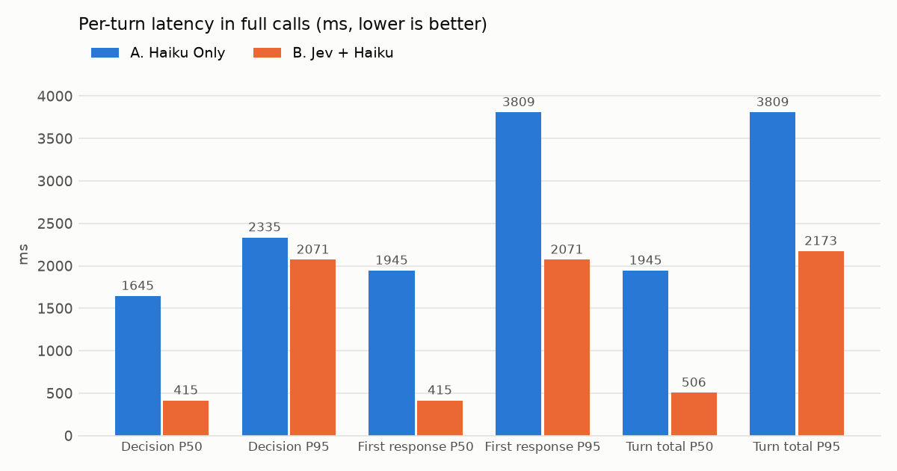
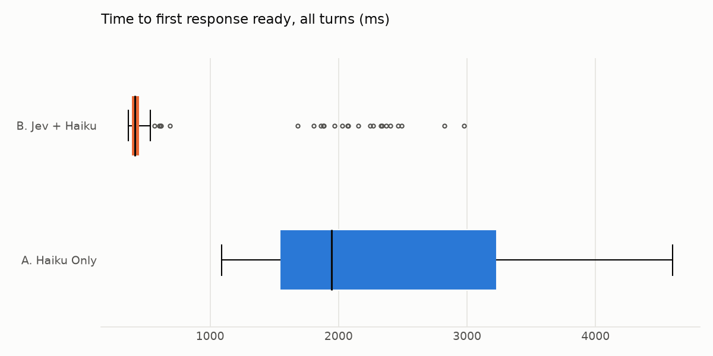
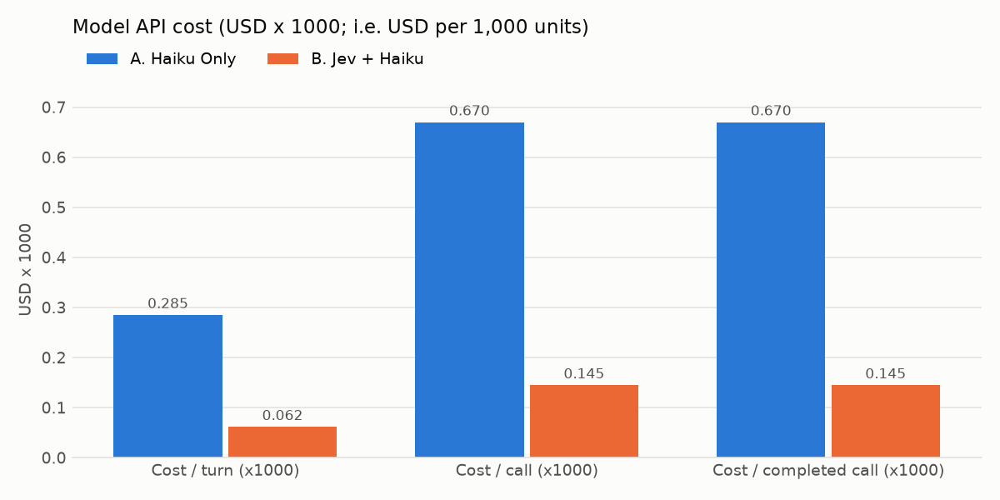
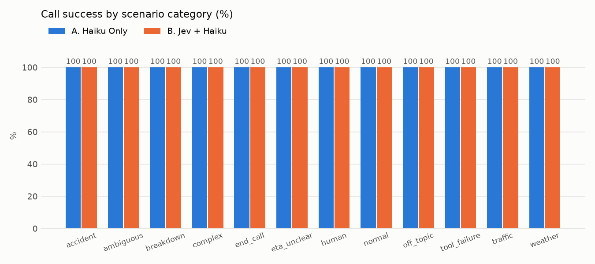
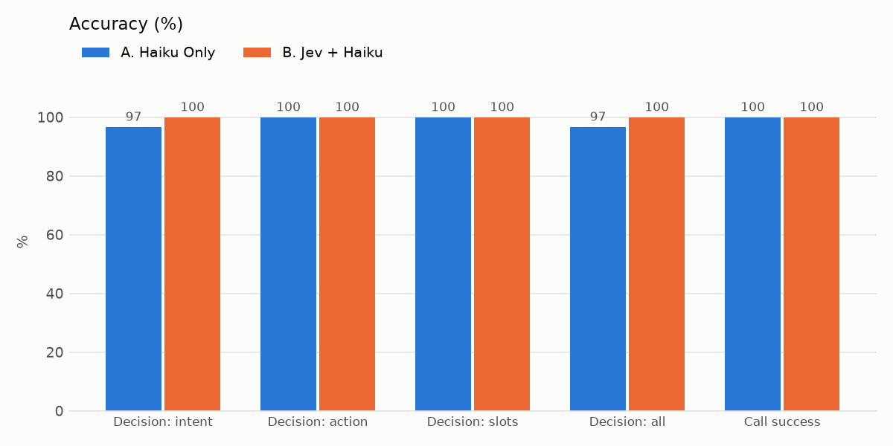
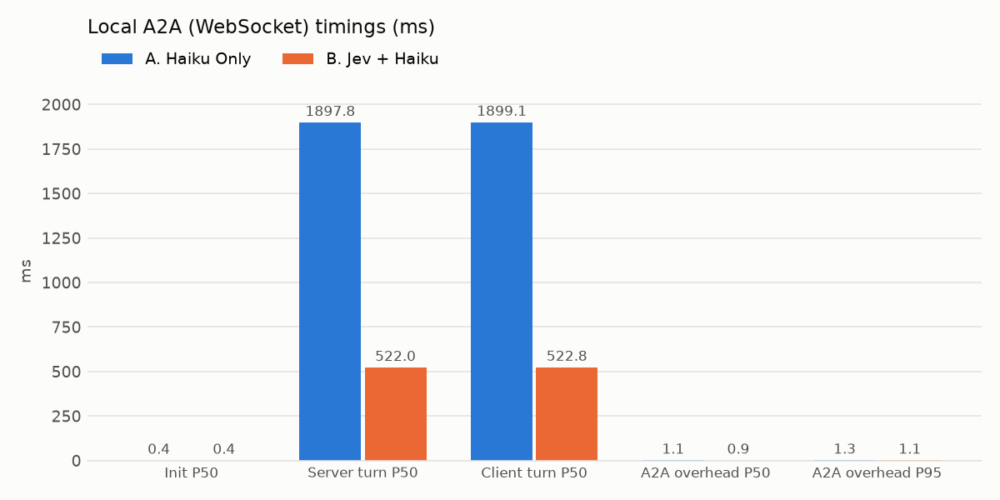

# Benchmark report — 20261117-183723

- Mode: **live**, reps: 5, seed: 20261117, concurrency: 4
- Haiku: `anthropic/claude-haiku-5.5` (reasoning=none); Jev: `typesafe/jev-1.14`, threshold 0.8
- TMS mock latency: 150 ms; spent: $0.1286; 2026-11-17 18:37:23 +0900 → 2026-11-17 18:44:02 +0900

## 1. Pure decision benchmark (engine + rule engine, no tools, no adapter)

| Metric | A. Haiku Only | B. Jev + Haiku |
|---|---:|---:|
| Decisions (n) | 150 | 150 |
| Errors | 0 | 0 |
| Accuracy (intent+action+slots) | 96.7% | 100.0% |
| Intent accuracy | 96.7% | 100.0% |
| Action accuracy | 100.0% | 100.0% |
| Slot accuracy | 100.0% | 100.0% |
| Decision time P50 / P95 (ms) | 1,577 / 2,358 | 448 / 2,341 |
| Decision time P50, no fallback (ms) | 1,577 | 428 |
| Decision time P50, with fallback (ms) | – | 1,994 |
| Time to first token P50 (ms) | 1,112 | 448 |
| Fallback rate | – | 16.7% |
| Accuracy without / with fallback | 96.7% / – | 100.0% / 100.0% |
| Input / output tokens per decision | 1731 / 121 | 1262 / 162 |
| Cost per decision | $0.0002334 | $0.0000808 |
| API calls by model | anthropic/claude-haiku-5.5: 150 | typesafe/jev-1.14-20261014: 150, anthropic/claude-haiku-5.5: 25 |

Fallback reasons (B): {'multiple_time_expressions': 5, 'off_topic': 10, 'low_confidence_intent': 10}

Accuracy by category:

| Category | A | B |
|---|---:|---:|
| accident | 100.0% | 100.0% |
| ambiguous | 100.0% | 100.0% |
| breakdown | 100.0% | 100.0% |
| complex | 100.0% | 100.0% |
| end_call | 100.0% | 100.0% |
| eta_unclear | 100.0% | 100.0% |
| human | 100.0% | 100.0% |
| normal | 88.9% | 100.0% |
| off_topic | 100.0% | 100.0% |
| traffic | 100.0% | 100.0% |
| weather | 100.0% | 100.0% |

Incorrect decisions — A. Haiku Only (case, text, intent, action, slots):

- d04 `20분에서 30분 사이요` → ambiguous, ASK_ISSUE, {"eta_minutes": 30, "issue": null, "delay_minutes": null}

## 2. Full conversation benchmark (direct orchestrator calls)

| Metric | A. Haiku Only | B. Jev + Haiku |
|---|---:|---:|
| Calls / turns | 100 / 235 | 100 / 235 |
| Call success (outcome + slots + TMS) | 100.0% | 100.0% |
| Outcome correct | 100.0% | 100.0% |
| Slots correct | 100.0% | 100.0% |
| Wrong terminations | 0 | 0 |
| Stuck (max turns) | 0 | 0 |
| Re-asks per call | 0.30 | 0.30 |
| Turns per call | 2.35 | 2.35 |
| Intent accuracy (per turn) | 97.9% | 100.0% |
| TMS failure reported correctly | 100.0% | 100.0% |
| Model decision P50 / P95 (ms) | 1,645 / 2,335 | 415 / 2,071 |
| Time to first token P50 (ms) | 1,190 | 415 |
| **First response ready P50 / P95 (ms)** | **1,945 / 3,809** | **415 / 2,071** |
| First response ready on tool turns P50 (ms) | 3,321 | 401 |
| Turn total P50 / P95 (ms) | 1,945 / 3,809 | 506 / 2,173 |
| Tool (TMS) time P50 (ms) | 151 | 151 |
| Scenario completion P50 / P95 (ms, agent time only) | 5,608 / 8,065 | 1,316 / 3,312 |
| Fallback rate (turns) | – | 8.5% |
| Model errors | 0 | 0 |
| API calls per call, by model | anthropic/claude-haiku-5.5: 3.30 | typesafe/jev-1.14-20261014: 2.35, anthropic/claude-haiku-5.5: 0.20 |
| Input / output tokens per call | 4881 / 364 | 2638 / 357 |
| Cost per turn | $0.0002851 | $0.0000617 |
| Cost per call | $0.000670 | $0.000145 |
| Cost per completed call | $0.000670 | $0.000145 |
| Cost for 1,000 calls | $0.670 | $0.145 |
| Cost for 10,000 calls | $6.70 | $1.45 |
| Share of cost from provider-reported usage | 100.0% | 100.0% |

Fallback reasons (B): {'off_topic': 10, 'multiple_time_expressions': 5, 'low_confidence_intent': 5}

Success by scenario:

| Scenario | A | B |
|---|---:|---:|
| c01 | 100.0% | 100.0% |
| c02 | 100.0% | 100.0% |
| c03 | 100.0% | 100.0% |
| c04 | 100.0% | 100.0% |
| c05 | 100.0% | 100.0% |
| c06 | 100.0% | 100.0% |
| c07 | 100.0% | 100.0% |
| c08 | 100.0% | 100.0% |
| c09 | 100.0% | 100.0% |
| c10 | 100.0% | 100.0% |
| c11 | 100.0% | 100.0% |
| c12 | 100.0% | 100.0% |
| c13 | 100.0% | 100.0% |
| c14 | 100.0% | 100.0% |
| c15 | 100.0% | 100.0% |
| c16 | 100.0% | 100.0% |
| c17 | 100.0% | 100.0% |
| c18 | 100.0% | 100.0% |
| c19 | 100.0% | 100.0% |
| c20 | 100.0% | 100.0% |

Costs are model API only (OpenRouter). Amazon Connect, STT/TTS, telephony and hosting are excluded — see docs/cost-model.md.

## 3. A2A adapter vs direct (local WebSocket, mock Connect client)

| Metric | A. Haiku Only | B. Jev + Haiku |
|---|---:|---:|
| Calls / turns | 18 / 45 | 18 / 45 |
| Protocol violations | 0 | 0 |
| Turns with TRACING_SPAN | 100.0% | 100.0% |
| FINISH type correct | 100.0% | 100.0% |
| WS connect P50 (ms) | 1 | 1 |
| INIT_SESSION → response P50 (ms) | 0.36 | 0.36 |
| First chunk at client P50 (ms) | 1,898 | 410 |
| Turn at client P50 / P95 (ms) | 1,899 / 3,881 | 523 / 1,546 |
| Turn inside server P50 (ms) | 1,898 | 522 |
| A2A overhead P50 / P95 (ms) | 1.1 / 1.3 | 0.9 / 1.1 |
| Direct (same scenarios) turn total P50 (ms) | 1,905 | 506 |

Overhead = client-observed turn time − server root span (`invoke_agent`) duration: JSON-RPC framing, trace serialization and loopback transport. Real Connect adds WAN latency and Connect-side processing that only a Phase 2 test in AWS can measure.

## Charts

